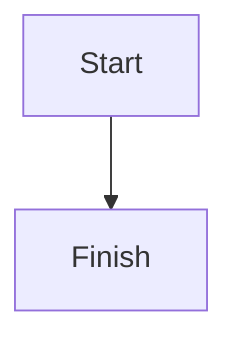

::breadcrumb

::toc

Intro paragraph with **bold**, *italic*, ~~strike~~, `inline :span[x]{color="red"} code`, a :span[red word]{color="red"}, a :span[highlight]{bg="yellow"}, :u[underlined], key :kbd[⌘ K], due :date[2026-11-10], owner :person[Ada Lovelace]{id="6650f0c2a1"} and :markdrop[Secret plan]{src="secret-plan"} and :markdrop[Open doc]{src="open-doc"}. {#b-k3x9a1 color="green"}

## Section one {bg="blue"}

- Item {bg="pink"}
- [ ] A to-do {color="orange"}
- [x] Done
1. Numbered

> A quote {color="gray"}

:::tip[A title]{icon="💡" color="blue"}
A shortcut or *good* practice.
:::

:::details{summary="Why does this happen?"}
Because of this.
:::

:::details{summary="FAQ" heading=2}
Questions and answers.
:::

```python
print("hello <b>")
```
{caption="A small example"}



| Name | Role {bg="blue"} |
| --- | --- |
| Ada {bg="yellow"} | Owner |

{header-column widths="120,240,"}

$E = mc^2$ inline and block:

$$
\int_0^1 x^2 dx
$$

{width="60%" align="left"}


::::columns
:::column{width="40%"}
Left column.
:::

:::column{width="60%"}
Right column.
:::
::::

A parent line.

:::indent
A line nested under it.
:::

:::button{label="Add a task"}
- [ ] New task
:::

::markdrop{src=secret-plan title="Top secret title"}
::markdrop{src=open-doc mode=card}
::page{src=kid}
::bookmark{url="https://example.com/post" title="The post" description="What it says" site="Example"}
::embed{src="https://www.youtube.com/watch?v=dQw4w9WgXcQ"}

---

