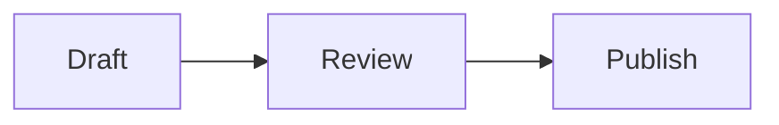

A Markdrop document is Markdown. You write it at [markdrop.in/new](https://markdrop.in/new), paste it from an AI assistant, or publish it from VS Code, and readers get a formatted page. This page covers what the renderer supports and how the editor helps.

## What renders

Markdrop supports GitHub-flavoured Markdown:

- Headings, **bold**, _italic_, ~~strikethrough~~, links and images.
- Bulleted, numbered and task lists (`- [x] Done`).
- Tables, which scroll sideways on a phone instead of squashing.
- Footnotes and autolinked URLs.
- Fenced code blocks with syntax highlighting and a copy button.

Two small extras: an inline code span that holds only a colour, like `` `#3B82F6` ``, shows a swatch next to it. Image links ending in `#gh-dark-mode-only` or `#gh-light-mode-only` show only in that theme, as they do on GitHub.

## Math

Write inline math between single dollar signs and display math between double ones. Markdrop renders it with KaTeX.

```markdown
The loss is $L = -\sum_i y_i \log \hat{y}_i$.

$$
\int_0^\infty e^{-x^2}\,dx = \frac{\sqrt{\pi}}{2}
$$
```

## Diagrams

A fenced block marked `mermaid` renders as a diagram instead of code:

````markdown

````

Flowcharts, sequence, class, state and entity-relationship diagrams, Gantt and pie charts, user journeys, Git graphs, mind maps, timelines and more all work. To see several at once, open the editor and choose **Try the diagrams sample**.


## What doesn't render

HTML tags inside a document aren't rendered: Markdrop drops them, so a document can't run scripts or change how the page around it looks. To publish an HTML page, upload it as a file. See [Publish an HTML page](/files/html-pages).

## The editor

The editor at [markdrop.in/new](https://markdrop.in/new) has three views: **Write**, **Split** (text and preview side by side, scrolling together) and **Preview**. Markdrop remembers which one you used last.

::clip{src="/docs-assets/documents/writing/writing-editor-views" alt="The editor switching from Write to Split, where the text and the rendered preview scroll together, then to Preview."}

The toolbar adds **Bold**, **Italic**, **Heading**, **Inline code**, **Code block**, **Link** and **List item** around your selection.

| Shortcut | What it does |
| --- | --- |
| :kbd[⌘ Enter] / :kbd[Ctrl Enter] | Publish |
| :kbd[⌘ S] / :kbd[Ctrl S] | Save, while editing a published document |

Under **More actions** you'll find **Export PDF**, **Load the diagrams sample** and **Clear editor**.

### Drafts

Until you publish, the editor keeps a draft on this device and restores it when you come back ("Restored your draft from this device"). Drafts are never kept while **Encrypt** is on.

### Size

A document can be up to 500,000 characters. The meter above the editor shows how many are left, and turns to a warning when fewer than 1,000 remain. With encryption on, it counts the encrypted size, which is larger than the text.

## Titles

The **Title** field is optional. Without one, Markdrop uses the document's first `#` heading, or else its first line, cut to 120 characters. The title shows in the browser tab, in **My files** and in link previews. Readers also see it above the document, unless the document starts with its own `#` heading: then only that heading shows.

## Edit after publishing

Open the document, press :kbd[Esc] or choose **Show details** to leave full screen, and choose **Edit**. The editor opens with the same views and toolbar, plus **Settings**, which opens **Document settings** for the password and expiry. Choose **Save changes**, or press :kbd[⌘ S].

Readers who have the page open see the change appear, marked "Updated just now".

If you aren't signed in as the owner, you'll need the document's edit secret. See [Edit with your edit secret](/documents/edit-key).

## What readers can do

Readers can copy a link to any heading with its **Copy link to section** button, read full screen, see the raw Markdown with **View raw**, and save a PDF with **Export PDF**. Signed-in readers can choose **Save a copy** to put their own copy in **My files**.

## More about documents

::::cards
:::card[Choose a link]{href="/documents/addresses" icon="link"}
Pick an address like markdrop.in/q3-plan, and change it later.
:::
:::card[Edit with your edit secret]{href="/documents/edit-key" icon="edit"}
Edit or delete a document you published without an account.
:::
:::card[Passwords and expiry]{href="/documents/passwords-and-expiry" icon="lock"}
Ask for a password, or have the link stop working on a date.
:::
:::card[Link previews]{href="/documents/link-previews" icon="image"}
What the card shows in Slack and other apps, and what it never shows.
:::
:::card[Build a README]{href="/documents/readme-builder" icon="builder"}
Assemble a README from ready-made sections and publish it.
:::
::::
