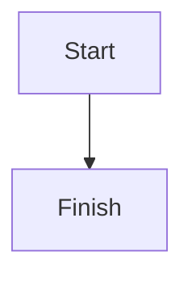

A page is stored as Markdown: GitHub-flavoured Markdown plus a few directives for the blocks Markdown doesn't have. The editor reads and writes exactly this, without changing what it doesn't touch, so a page written by hand, by VS Code or by an AI app opens in the block editor as it was written. AI apps use the same syntax with `get_page`, `update_page`, `append_blocks` and `create_page`.

## Page properties

The page's icon, cover and options sit in front matter at the top. Every key is optional.

```yaml
---
icon: 🚀                 # an emoji, or asset:<id> for an uploaded image
cover: gallery:dawn      # gallery:<name>, asset:<id>, or an https:// image
cover_y: 40              # the cover's focal point, 0 (top) to 100 (bottom); default 50
full_width: true
small_text: true
font: serif              # default, serif or mono
locked: true             # only the owner and workspace admins can edit
allow_export: false      # readers can't export it; editors always can
---
```

The built-in covers come in four sets: paper (`mist`, `linen`, `graphite`), duotone (`fold`, `halftone`, `dusk`), lines (`contour`, `blueprint`, `strata`) and calm (`dawn`, `sage`, `moonlit`). A page that uses a name from the first gallery (`aurora`, `sunset`, `ocean`, `forest`, `peach`, `sand`, `slate` or `mint`) shows the closest of these. The page's title isn't in the front matter: it's the document's title.

## Text

| Block | Markdown |
| --- | --- |
| Heading 1, 2, 3 | `# Title`, `## Title`, `### Title` |
| Bold, italic, strikethrough | `**bold**`, `*italic*`, `~~strike~~` |
| Inline code | `` `code` `` |
| Link | `[text](https://example.com)` |
| Quote | `> Quoted text` |
| Divider | `---` |
| Inline and block math | `$E = mc^2$` and a `$$` … `$$` block |
| Emoji | the character itself: 🚀 |

## Lists

```markdown
- Bulleted item
  - Nested item
1. Numbered item
- [ ] To-do
- [x] Done
```

## Toggles

A toggle hides its content until opened. A toggle heading has a heading-sized summary.

```markdown
:::details{summary="Why does this happen?"}
Because of this.
:::

:::details{summary="FAQ" heading=2}
Questions and answers.
:::
```

`:::details[Summary]` (the summary as a label) works too.

## Callouts

```markdown
:::note
Background or context.
:::

:::tip[A title]
A shortcut or good practice.
:::

:::warning{icon="⏳" color=yellow}
Something to be careful about, with its own emoji and background.
:::

:::danger
Data loss or a security risk.
:::
```

Colours: `gray`, `brown`, `orange`, `yellow`, `green`, `blue`, `purple`, `pink`, `red`.

## Code and diagrams

````markdown
```python
print("hello")
```


````

## Tables

```markdown
| Case | Expected |
| --- | --- |
| Sign in | Dashboard opens |
```

## Images

```markdown


```

`asset:<id>` is an image uploaded to this page. See [Images in pages](/pages/images).

## Markdrop items

```markdown
::markdrop{src=q3-report}
::markdrop{src=pricing-calculator mode=preview}
::markdrop{src=team-handbook mode=card title="Our handbook"}

Read :markdrop[the launch plan]{src=launch-plan} first.
```

- `src` is the item's link name (the part after `markdrop.in/`); a full `https://markdrop.in/<name>` link works too.
- `mode` is `live` (the default), `preview` or `card`.
- In a mention, the text in brackets is a label for people reading the Markdown; readers see the item's own title, or **Restricted item**.
- Someone who can't open the item never gets its label or `title`: in the Markdown they read (the raw view, an AI app's `get_page`, a copy) the mention is `:markdrop[]{src=…}` and the embed has no `title`. When they save, the labels come back from the page.

See [Embed and mention Markdrop items](/pages/embed-and-mention).

## Sub-pages, contents and breadcrumbs

```markdown
::page{src=launch-sync}
::toc
::breadcrumb
```

- `::page` links a sub-page by its link name.
- `::toc` lists the page's headings and stays up to date.
- `::breadcrumb` shows where the page sits among its parents.

## Links, web embeds and bookmarks

```markdown
::bookmark{url="https://example.com/post" title="The post" description="What it says" image="https://example.com/cover.png" site="Example"}
::embed{src="https://www.youtube.com/watch?v=dQw4w9WgXcQ"}
```

A bookmark keeps its title, description and image in the Markdown, so readers never fetch anything from the site. Web embeds work for YouTube, Vimeo, Loom, Figma, Google Maps and CodePen links; any other address shows as unavailable.

## People and dates

```markdown
Due :date[2026-11-10], owner :person[Ada Lovelace]{id=6650f0c2a1}.
```

Dates are `YYYY-MM-DD`. A person is a member of the page's workspace, by their account id. AI apps get the ids from `list_workspace_members`.

You can also write just the name, `:person[Ada Lovelace]`. When the page is saved, by you or an AI app, Markdrop looks the name up among the members of the page's workspace, ignoring upper and lower case. If exactly one member has that name, the mention gets their id and works like one you picked from the list. If nobody has it, or more than one member does, it stays as you wrote it and shows as plain text; an AI app is told which names weren't found. Names are looked up only when whoever saves is a member of the page's workspace, and only in pages.

A person's name shows only to the page's owner and the members of its workspace. Everyone else, including the Markdown an AI app reads for them, gets `:person[]{id=…}`, shown as "a person".

## Keys

```markdown
Press :kbd[⌘ K] to search.
```

`:kbd[…]` shows a keyboard key.

## Colours and underline

```markdown
A :span[red word]{color="red"}, a :span[highlight]{bg="yellow"} and :u[underlined text].
```

The colours are `gray`, `brown`, `orange`, `yellow`, `green`, `blue`, `purple`, `pink` and `red`. A `:span` takes either `color` (the text) or `bg` (the background), not both.

## Block options

A block's colour, its link name and other options go in braces at the end of the block. For tables, code blocks, dividers and equations, they go on a line of their own just after the block:

````markdown
A paragraph in green, with a link name. {#b-k3x9a1 color="green"}

### A heading on a blue background {bg="blue"}

- An item {bg="pink"}
- [ ] A to-do {color="orange"}

> A quote {color="gray"}

{width="60%" align="left"}

```js
console.log("hello");
```
{caption="A small example"}

| Name | Role {bg="blue"} |
| --- | --- |
| Ada {bg="yellow"} | Owner |

{header-column widths="120,240,"}
````

- `#b-…` is the block's link name: `b-` and then 4 to 12 lowercase letters or digits. A link to the page ending in `#b-k3x9a1` opens it at that block. **Copy link to block** adds a link name.
- `color` and `bg` take the colours above. In a table cell, they colour the cell.
- An image's `width` is a percentage. Its `align` is `left`, `center` (the default) or `right`.
- A table's `widths` are its column widths in pixels, left to right. An empty value means automatic.
- `header-column` styles a table's first column. `header-row="off"` makes its first row an ordinary row.
- A toggle or callout takes its colour in its own braces: `:::details{summary="More" color="blue"}`, `:::note{color="green"}`.
- Braces that aren't a list of these options stay as text, and so does a brace written `\{`.

## Columns, nesting and buttons

```markdown
::::columns
:::column{width="40%"}
Left column.
:::

:::column{width="60%"}
Right column.
:::
::::

A parent line.

:::indent
A line nested under it.
:::

:::button{label="Add a task"}
- [ ] New task
:::
```

- `::::columns` holds two to five `:::column` blocks. `width` is optional.
- `:::indent` holds the blocks nested under the block before it.
- A `:::button` holds the blocks that clicking it inserts. Readers don't see buttons.
- An outer fence needs more colons than the fences inside it. For example, columns that hold a callout use `:::::columns`, then `::::column`, then `:::note`.

## Anything else

Markdown the editor doesn't model, such as raw HTML or footnote definitions, is kept exactly as written and shown as a Markdown block in the editor. Raw HTML is never rendered for readers.
