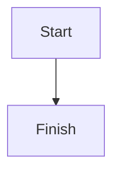

A page is stored as Markdown: GitHub-flavoured Markdown plus a few directives for the blocks Markdown doesn't have. The editor reads and writes exactly this, without changing what it doesn't touch, so a page written by hand, by VS Code or by an AI app opens in the block editor as it was written. AI apps use the same syntax with `get_page`, `update_page`, `append_blocks` and `create_page`.

## Page properties

The page's icon, cover and options sit in front matter at the top. Every key is optional.

```yaml
---
icon: 🚀                 # an emoji, or asset:<id> for an uploaded image
cover: gallery:dawn      # gallery:<name>, asset:<id>, or an https:// image
cover_y: 40              # the cover's focal point, 0 (top) to 100 (bottom); default 50
full_width: true
small_text: true
font: serif              # default, serif or mono
locked: true             # only the owner and workspace admins can edit
---
```

The built-in covers come in four sets: paper (`mist`, `linen`, `graphite`), duotone (`fold`, `halftone`, `dusk`), lines (`contour`, `blueprint`, `strata`) and calm (`dawn`, `sage`, `moonlit`). A page that uses a name from the first gallery (`aurora`, `sunset`, `ocean`, `forest`, `peach`, `sand`, `slate` or `mint`) shows the closest of these. The page's title isn't in the front matter: it's the document's title.

## Text

| Block | Markdown |
| --- | --- |
| Heading 1, 2, 3 | `# Title`, `## Title`, `### Title` |
| Bold, italic, strikethrough | `**bold**`, `*italic*`, `~~strike~~` |
| Inline code | `` `code` `` |
| Link | `[text](https://example.com)` |
| Quote | `> Quoted text` |
| Divider | `---` |
| Inline and block math | `$E = mc^2$` and a `$$` … `$$` block |
| Emoji | the character itself: 🚀 |

## Lists

```markdown
- Bulleted item
  - Nested item
1. Numbered item
- [ ] To-do
- [x] Done
```

## Toggles

A toggle hides its content until opened. A toggle heading has a heading-sized summary.

```markdown
:::details{summary="Why does this happen?"}
Because of this.
:::

:::details{summary="FAQ" heading=2}
Questions and answers.
:::
```

`:::details[Summary]` (the summary as a label) works too.

## Callouts

```markdown
:::note
Background or context.
:::

:::tip[A title]
A shortcut or good practice.
:::

:::warning{icon="⏳" color=yellow}
Something to be careful about, with its own emoji and background.
:::

:::danger
Data loss or a security risk.
:::
```

Colours: `gray`, `brown`, `orange`, `yellow`, `green`, `blue`, `purple`, `pink`, `red`.

## Code and diagrams

````markdown
```python
print("hello")
```


````

## Tables

```markdown
| Case | Expected |
| --- | --- |
| Sign in | Dashboard opens |
```

## Images

```markdown


```

`asset:<id>` is an image uploaded to this page. See [Images in pages](/pages/images).

## Markdrop items

```markdown
::markdrop{src=q3-report}
::markdrop{src=pricing-calculator mode=preview}
::markdrop{src=team-handbook mode=card title="Our handbook"}

Read :markdrop[the launch plan]{src=launch-plan} first.
```

- `src` is the item's link name (the part after `markdrop.in/`); a full `https://markdrop.in/<name>` link works too.
- `mode` is `live` (the default), `preview` or `card`.
- In a mention, the text in brackets is a label for people reading the Markdown; readers see the item's own title, or **Restricted item**.

See [Embed and mention Markdrop items](/pages/embed-and-mention).

## Sub-pages, contents and breadcrumbs

```markdown
::page{src=launch-sync}
::toc
::breadcrumb
```

- `::page` links a sub-page by its link name.
- `::toc` lists the page's headings and stays up to date.
- `::breadcrumb` shows where the page sits among its parents.

## Links, web embeds and bookmarks

```markdown
::bookmark{url="https://example.com/post" title="The post" description="What it says" image="https://example.com/cover.png" site="Example"}
::embed{src="https://www.youtube.com/watch?v=dQw4w9WgXcQ"}
```

A bookmark keeps its title, description and image in the Markdown, so readers never fetch anything from the site. Web embeds work for YouTube, Vimeo, Loom, Figma, Google Maps and CodePen links; any other address shows as unavailable.

## People and dates

```markdown
Due :date[2026-11-10], owner :person[Ada Lovelace]{id=6650f0c2a1}.
```

Dates are `YYYY-MM-DD`. A person is a member of the page's workspace, by their account id.

## Anything else

Markdown the editor doesn't model, such as raw HTML or footnote definitions, is kept exactly as written and shown as a Markdown block in the editor. Raw HTML is never rendered for readers.
