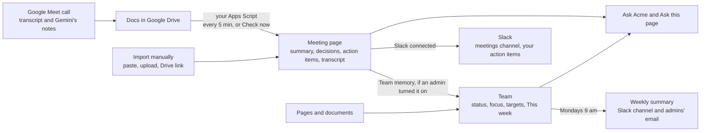

A call in Google Meet can end up in four places in Markdrop: a **meeting page** with its summary, the **Team** board, answers in **Ask**, and messages in **Slack**. This page shows how each step feeds the next, what you set up once, and who sees what along the way.

::video{id="team-meetings" title="Your workspace remembers: meetings become pages, Team shows who's on what, and you can just ask" duration="2:23"}

## 1. The call becomes Docs in Google Drive

Google Meet saves a **transcript** (when **Transcripts** is on in the call) and **Gemini's notes** (with **Take notes for me**) as Google Docs in the Drive of whoever turned them on, and shares them with the people invited. Gemini makes its notes Doc when note-taking starts and fills it in when the call ends.

## 2. The script sends them to Markdrop

[Connect Google Meet](/workspaces/meetings-auto-import) once: Markdrop writes a small Google Apps Script for you, and you paste it into your own Google account. Every 5 minutes it looks for new meeting Docs, yours and the ones shared with you, and sends them to your workspace's Meetings inbox. Read-only: it never changes your Drive.

- A Doc Google hasn't filled in yet waits. The Meetings page says *1 meeting waiting for Gemini's notes* until Google writes them, and the script sends it on the next run after that.
- **Check for new meetings** on the Meetings page runs the script right away, once the person who connected it has [turned Check now on](/workspaces/meetings-auto-import#check-for-new-meetings).
- When several people connect, each call is still imported once.

Zoom, Teams and other calls come in by [importing them manually](/workspaces/meetings-import): paste a transcript, upload a file or paste a Drive link.

## 3. Markdrop writes the meeting page

Each call becomes one page in **Meetings › its series** (or **Other meetings**), with the notes and the transcript of one call put together. It holds the summary, decisions, action items with their owners @mentioned (nobody is notified), open questions, topics and the transcript, each point linked to the moment it was said. See [Meetings](/workspaces/meetings).

- **Attendees** are the people who joined. Gemini's notes list everyone on the invite, joined or not: Markdrop keeps them apart as **Invited**. See [Attendees and invited](/workspaces/meetings-import#attendees-and-invited).
- A 1:1 or a two-person call is **restricted to its attendees**; three or more people are open to the workspace's team. You can change it per meeting. See [Privacy and AI](/workspaces/meetings-privacy).

## 4. Team memory reads it, if it's on

[Team](/workspaces/team) is **off until a workspace admin turns it on**. Then it reads each meeting once its summary is written, and pages 10 minutes after their last save, and keeps short, dated lines about each member: what they're working on, what they finished, targets with due dates, blockers. The board shows a card per person, a **This week** card, and projects.

- People set their own **status** and **focus**, and fix lines about themselves: **Mark done**, **Hide**, **This is wrong**.
- Every Monday at 9 am in the workspace's timezone, the **weekly summary** goes to the Slack meetings channel and the admins' email, and becomes the This week card.

## 5. Ask and Slack use it

- **Ask.** **Ask Acme** (your workspace's name) answers from its meetings, pages and Team memory: "What is Priya working on?", "What did we decide about pricing?". **Ask this page** adds what meetings decided about the page you're on. See [Ask Markdrop](/workspaces/ask-markdrop) and [Ask your meetings](/workspaces/meetings-ask).
- **While writing.** **From meetings** in a page shows what was decided about it and inserts a cited line. See [Meeting memory while writing](/pages/meeting-memory).
- **Slack.** With [Slack connected](/integrations/slack), each meeting's summary and action items are posted to the meetings channel with **Done** buttons, and everyone in the meeting with an action item (attendees, people invited and the organizer) gets their own items as a direct message, with **Stop these**. `/markdrop ask` asks like **Ask Acme**.
- **AI apps.** The [MCP tools](/ai/tools#meetings) cover every step: import and read meetings, check for new ones, read Team, set your status, mark your items done, and, for admins, groups and the weekly summary.

## Set it up

| Who | What | Where |
|---|---|---|
| Each person who records calls | Connect Google Meet, paste the script, run `setup` | [Import meetings automatically](/workspaces/meetings-auto-import) |
| The same person, once | Turn on Check now (a web app deployment of the script) | [Check for new meetings](/workspaces/meetings-auto-import#check-for-new-meetings) |
| A workspace admin | Turn on Team memory, check the weekly summary's timezone | [Team](/workspaces/team#turn-it-on) |
| A workspace admin | Make groups for the board's filters | [Groups](/workspaces/team#groups) |
| A workspace admin | Connect Slack and pick the meetings channel | [Slack](/integrations/slack) |
| Everyone | Set your status and focus; fix lines about you | [Your status and focus](/workspaces/team#your-status-and-focus) |

New to Markdrop? **Start with your team** on [markdrop.in](https://markdrop.in) (or go to [markdrop.in/meetings/start](https://markdrop.in/meetings/start)) signs you in, then opens **Meetings** in your first workspace with the **Connect Google Meet** steps. With no workspace yet, it creates one first.

## Who sees what

Every step keeps the meeting's own access:

- A meeting **restricted to its attendees** is only on their Meetings page, only in their Ask answers, only on their Team pages, and never in the weekly summary or posted to a Slack channel.
- Team lines are decided for each viewer when they open Team: a line shows only while you can open the meeting or page it came from.
- The weekly summary uses only meetings and pages **everyone in the workspace** can open.
- Action-item messages in Slack carry only that person's own items. People who aren't in your Markdrop workspace get the item text, not the notes.

## AI limits

Meetings and Team memory have fair-use limits, like every AI feature. What's sent to the AI is in [AI and your data](/security/ai-and-your-data).

- When a limit is reached, meetings still import, with their transcript and Google's notes but without the AI sections; **Write it again** adds them later. See [Privacy and AI](/workspaces/meetings-privacy#ai).
- Team stops updating for a while and picks up again by itself; nothing is lost. See [Team › AI](/workspaces/team#ai).
