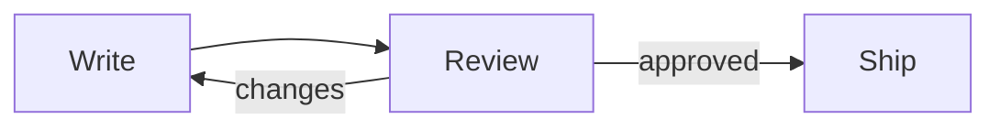

# Launch notes

Review closes **Thursday**. We ship Workflows to every Acme workspace on **Friday**.



## Who does what

| Step | Owner | Due |
| --- | --- | --- |
| Final copy | Riya | Wed |
| Review | Alex, Sam | Thu |
| Release | Maya | Fri 10:00 |

## Turn it on

```bash
acme workflows enable --all-workspaces
```

- [x] Docs updated
- [x] Pricing page live
- [ ] Announcement email
